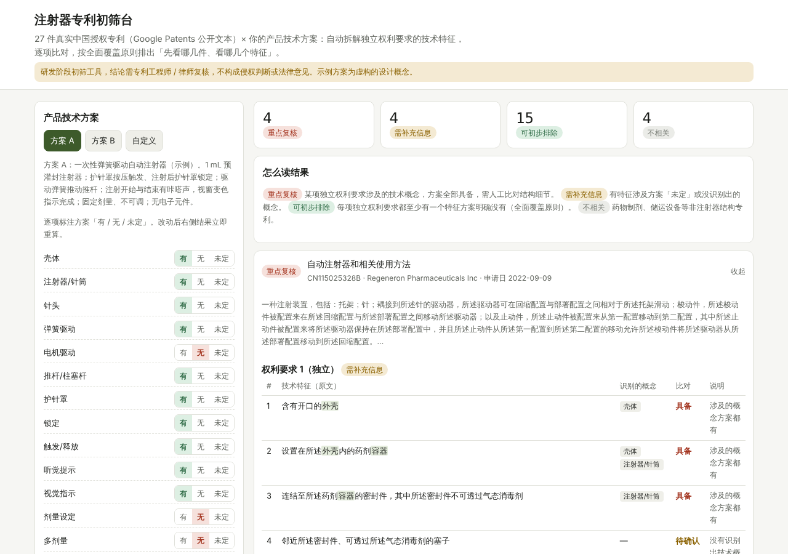

# injector-patent-screener：注射器专利初筛台

个人项目。专利文本是 Google Patents 上真实的中国授权专利。

> **一句话**：研发阶段输入产品技术方案，工具从 27 件真实注射器专利中拆出每项独立权利要求的技术特征，逐项比对，按全面覆盖原则排出「先看哪几件、看哪几个特征」，并生成权利要求对比表（claim chart）给专利工程师复核。



**这是初筛工具，不是侵权判断。** 结论需要专利工程师或律师复核；示例方案 A / B 是虚构的设计概念，不对应任何真实产品。

## 解决什么问题

器械企业立项和改设计时都要做专利排查（FTO）。完整 FTO 要律师逐件读，费用高、周期长；研发前期更需要的是一个快速初筛：几十件相关专利里，哪几件和我的方案重合度最高、具体卡在哪个特征上，好让工程师尽早规避或补充信息。

## 做法

1. **采集**：在 Google Patents 检索「自动注射器」「注射笔」「自动注射器 + 高粘度」，取 27 件中国授权专利（礼来、赛诺菲、安进、诺和诺德、再生元、威高等），抓取标题、摘要、权利要求和申请人。
2. **拆解**：识别独立权利要求（不引用其他权利要求的），按「包括：…；…」和「其特征在于」切成技术特征。
3. **概念识别**：注射器领域 30 个技术概念的词典（驱动弹簧、护针罩、电机、处理单元、无线通信、阻尼机构、齿轮……），给每个特征打标签。
4. **逐项比对**：产品方案对每个概念标注「有 / 无 / 未定」。特征涉及的概念方案都有 → 具备；方案明确没有 → 不具备；其他 → 待确认。
5. **全面覆盖原则**：独立权利要求只要有一个特征不具备，就不落入字面保护范围 → 可初步排除；全部具备 → 重点复核；其余 → 需补充信息。
6. **两类专门处理**：药物制剂、储运设备类专利标为不相关；方法权利要求保护的是制造或使用过程，不能只拿产品结构比对，一律标为需补充信息。

## 结果（两个示例方案）

| 方案 | 重点复核 | 需补充信息 | 可初步排除 | 不相关 |
|---|---|---|---|---|
| A：一次性弹簧驱动自动注射器 | 4 | 4 | 15 | 4 |
| B：胰岛素笔智能注射记录模块 | 1 | 7 | 15 | 4 |

27 件专利从人工逐件阅读，缩小到每个方案只需重点看 4–5 件，而且对比表会标出具体是哪个特征需要比对。

## 迭代中发现并修正的问题

- **只靠通用词会误报**：最初概念词典只有「壳体、针头、弹簧」这类通用词，一件含「阻尼器机构」的专利被判成方案 A 全部具备。加入阻尼、扭簧、齿轮、凸轮、螺纹、棘轮、阀泵等具体机构概念（示例方案默认未定）后，这类专利转为需补充信息，重点复核从 7 件降到 4 件。
- **方法权利要求被当成产品比对**：「制造一系列自动注射器的方法」被判成重点复核，改为单独标注。
- **短特征被丢弃**：特征切分时把少于 4 个字的特征（如「壳体」）过滤掉了，违反全面覆盖原则「每个特征都要比」，单元测试发现后修正。

## 局限

- 概念级比对只判断「有没有这类部件」，判断不了部件之间的连接关系和具体结构，这正是「重点复核」需要人工完成的部分；
- 没有处理等同侵权，也没有核实法律状态（年费、无效），实际使用要以国家知识产权局公告为准；
- 词典是人工整理的，换领域（如输注泵）需要重新整理。下一步计划用大模型做特征拆解和概念识别，词典作为校验。

**技术栈**：Python · 正则 / 规则引擎 · 权利要求解析 · 原生 JS 前端（与 Python 同一套判定逻辑，结果逐件一致）· unittest

## 运行

```bash
python -m pts.parse     # 解析 data/raw/patents.json → data/clean/patents.json
python -m pts.screen    # 两个示例方案的初筛结果 → results/screening.json
python -m unittest discover -s tests -t .
cd web && python -m http.server 8000
```
